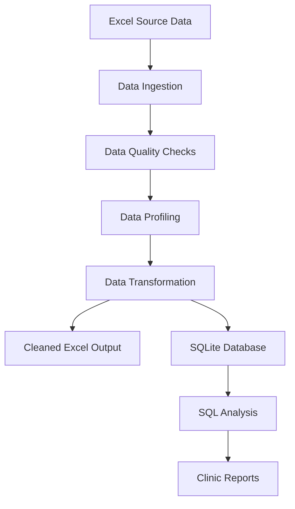

# Clinic Data Pipeline

A Python-based Data Engineering project designed to ingest, validate, transform, and load clinic scheduling data into a structured SQLite database.

## Project Overview

This project demonstrates a complete ETL (Extract, Transform, Load) workflow using clinic schedule data stored in Excel.

The pipeline performs data quality checks, generates data profiling reports, cleans text fields, exports processed data, loads records into SQLite, and executes SQL queries for analysis.

## Technologies Used

- **Python 3.13**
- **Pandas** – Data processing and transformation
- **OpenPyXL** – Excel file handling
- **SQLite** – Relational database storage
- **SQL** – Data querying and analysis
- **Pytest** – Automated testing
- **Git & GitHub** – Version control

## Pipeline Architecture



## Pipeline Workflow

1. **Data Ingestion**
   - Read clinic scheduling data from Excel.
   - Load the specified worksheet into Pandas.

2. **Data Quality Checks**
   - Identify missing values.
   - Check missing clinic and doctor names.
   - Detect exact duplicate records.
   - Identify records without schedules.
   - Check duplicates using clinic and schedule business keys.

3. **Data Profiling**
   - Calculate total records.
   - Identify unique doctors and clinics.
   - Analyze repeated doctor names.
   - Calculate records per clinic.

4. **Data Transformation**
   - Remove unnecessary leading and trailing spaces.
   - Standardize whitespace-only cells as missing values.
   - Preserve original records and columns.

5. **Data Export**
   - Save the cleaned dataset as an Excel file.

6. **Database Creation**
   - Create an SQLite database.
   - Create the clinic schedules table.

7. **Data Loading**
   - Load processed records into SQLite.
   - Validate loaded records.

8. **SQL Analysis**
   - Calculate the number of distinct doctors per clinic.
   - Sort clinics by doctor count.

9. **Automated Testing**
   - Verify record preservation.
   - Test whitespace removal.
   - Verify missing-value preservation.

## Dataset Summary

The development dataset produced the following results:

| Metric | Result |
|---|---:|
| Total Records | 238 |
| Unique Doctors | 219 |
| Unique Clinics | 46 |
| Missing Doctor Names | 0 |
| Missing Clinic Names | 0 |
| Exact Duplicate Rows | 0 |
| Records Without Schedules | 7 |
| Automated Tests Passed | 3 |

*These figures describe the development dataset and are not a live operational report.*

## Project Structure

```text
clinic_data_pipeline/
│
├── data/
│   ├── raw/
│   ├── processed/
│   └── clinic_data.db
│
├── src/
│   ├── ingestion/
│   ├── transformation/
│   │   ├── cleaning.py
│   │   └── quality_checks.py
│   └── database/
│       ├── db.py
│       ├── load_data.py
│       └── run_queries.py
│
├── sql/
│   └── queries.sql
│
├── tests/
│   └── test_cleaning.py
│
├── main.py
├── requirements.txt
├── README.md
└── .gitignore
```

## Installation and Setup

### 1. Clone the repository

```bash
git clone https://github.com/gihad-colb/clinic-data-pipeline.git
cd clinic-data-pipeline
```

### 2. Create a virtual environment

```bash
python -m venv .venv
```

### 3. Activate the environment

Windows PowerShell:

```powershell
.venv\Scripts\Activate.ps1
```

### 4. Install dependencies

```bash
pip install -r requirements.txt
```

### 5. Prepare the input dataset

Place an authorized, anonymized or synthetic Excel workbook at:

```text
data/raw/OPD_Schedule_2026_Formatted.xlsx
```

The workbook must contain a worksheet named:

```text
دليل العيادات
```

### 6. Run the pipeline

```bash
python main.py
```

### 7. Run automated tests

```bash
python -m pytest -v
```

## Output

The pipeline generates:

- A cleaned Excel dataset in `data/processed/`.
- An SQLite database in `data/clinic_data.db`.
- SQL analysis results displayed in the terminal.

## Data Privacy

This repository contains the project code, not the original hospital scheduling workbook or its SQLite database.

Real hospital, doctor, employee, and patient information must not be uploaded to a public repository. Use synthetic or properly anonymized data for demonstrations.

## Future Improvements

- Add automated data validation rules.
- Introduce structured logging and error handling.
- Add more comprehensive unit and integration tests.
- Support multiple input file formats.
- Add a reporting dashboard.
- Explore workflow orchestration and scheduled pipeline execution.

## Author

**Data Engineering Portfolio Project**

GitHub: https://github.com/gihad-colb

