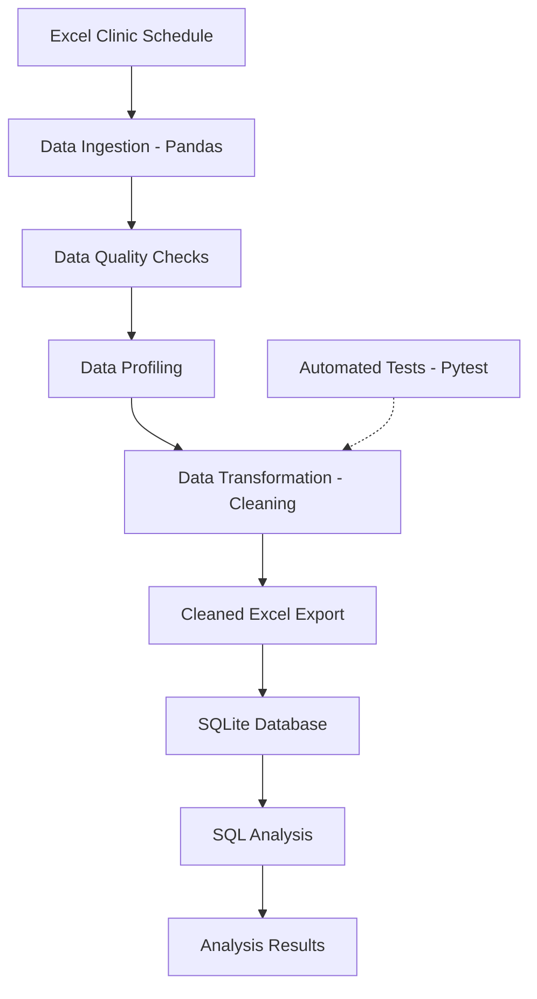

# Clinic Data Pipeline

A Python-based Data Engineering project that processes outpatient clinic scheduling data from Excel, performs data quality checks and transformations, and loads the results into an SQLite database for analysis.

## Project Overview

This project demonstrates a simple ETL (Extract, Transform, Load) pipeline using real-world clinic scheduling data.

The pipeline is designed to:
- Extract clinic schedule data from Excel.
- Validate data quality and identify missing values.
- Generate data profiling reports.
- Clean text fields and standardize empty values.
- Export cleaned data to Excel.
- Load the transformed data into SQLite.
- Run SQL queries to analyze clinic and doctor distribution.
- Execute automated tests using Pytest.

## Technologies Used

- Python
- Pandas
- OpenPyXL
- SQLite
- SQL
- Pytest
- Git & GitHub

## Pipeline Workflow

1. Data Ingestion
2. Data Quality Checks
3. Data Profiling
4. Data Transformation
5. Data Export
6. Database Creation
7. Data Loading
8. Database Validation
9. SQL Analysis
10. Automated Testing

## Project Structure

```text
clinic_data_pipeline/
│
├── data/
│   ├── raw/
│   ├── processed/
│   └── clinic_data.db
│
├── src/
│   ├── ingestion/
│   ├── transformation/
│   │   ├── cleaning.py
│   │   └── quality_checks.py
│   │
│   └── database/
│       ├── db.py
│       ├── load_data.py
│       └── run_queries.py
│
├── sql/
│   └── queries.sql
│
├── tests/
│   └── test_cleaning.py
│
├── main.py
├── requirements.txt
└── README.md
```

## Dataset Summary

The development dataset contains:

- Total Records: 238
- Unique Doctors: 219
- Unique Clinics: 46
- Missing Doctor Names: 0
- Missing Clinic Names: 0
- Exact Duplicate Rows: 0
- Records Without a Schedule: 7

## Installation

Clone the repository:

```bash
git clone https://github.com/gihad-colb/clinic-data-pipeline.git
cd clinic-data-pipeline
```

Create a virtual environment:

```bash
python -m venv .venv
```

Activate it on Windows:

```powershell
.venv\Scripts\Activate.ps1
```

Install dependencies:

```bash
pip install -r requirements.txt
```

## Input Data

Place the Excel input file in:

```text
data/raw/OPD_Schedule_2026_Formatted.xlsx
```

The workbook should contain a sheet named:

```text
دليل العيادات
```

Note: The original operational dataset is not included in this public repository.

## Run the Pipeline

```bash
python main.py
```

## Run Automated Tests

```bash
python -m pytest -v
```

## Outputs

- Cleaned Excel dataset.
- SQLite database.
- SQL analysis results.
- Automated test results.

## Data Privacy

This repository contains project code and documentation only. Real hospital operational data and confidential records are excluded.

## Author

GitHub: https://github.com/gihad-colb

Project: Clinic Data Pipeline

## Architecture Diagram

The following diagram illustrates the end-to-end data pipeline architecture:


